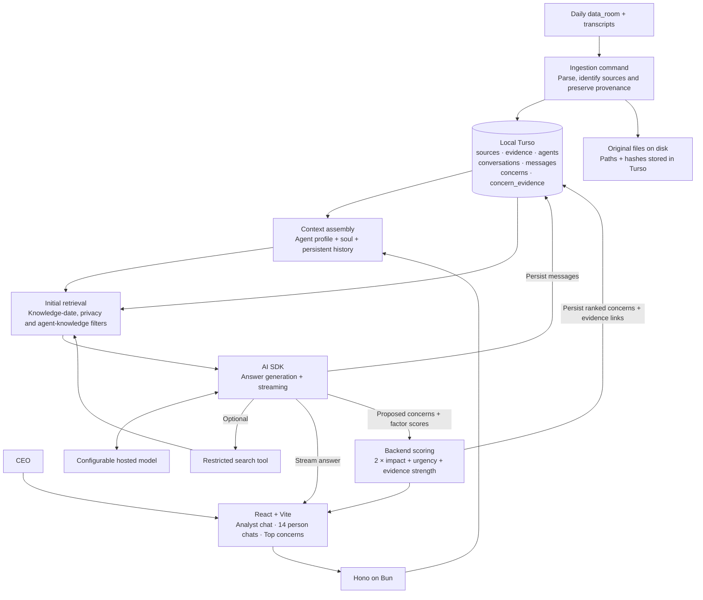

# Architecture



## Goal

Build a conversational company analyst backed by structured facts and retrievable source evidence. Support 14 interviewable people, cited answers with confidence, a ranked concern view, and point-in-time queries. Keep unsupported conclusions and invented character details distinct from recorded facts.

Product boundary clarified by the owner on 16 November 2026: the product is a website with 14 person agents and a CEO chat interface. Its recurring data inputs are each day's `data_room` and `transcripts` folders, including leadership calls and CEO voice-note transcripts. Repository Markdown files (`README.md`, `ARCHITECTURE.md`, `ASSUMPTIONS.md`, `TRANSCRIPT_NOTES.md`, `DECISIONS.md` and `AI_LOG.md`) are development records, not ingestion inputs. Transcripts provide attributed runtime evidence; their product requests also guide development rather than automatically modifying application behavior.

The confirmed design combines a structured database for people and dated records with searchable source passages. The language model composes cited answers and performs arithmetic from retrieved evidence. Backend code enforces date and access filters. Model calculations may be less reproducible and require numerical test cases; the search implementation and model remain open decisions.

The website has two chat paths: a general analyst chat retrieves company evidence directly, and selecting a person opens that agent’s profile and its separate CEO conversation history. Both use the shared AI SDK implementation. General company questions do not require the analyst to consult all 14 person agents. Analyst conversations use the same conversation/message tables with an analyst kind and no person-agent ID.

For now, use the AI SDK with one configurable hosted provider and model for both cockpit and person-agent answers, as selected by the owner on 16 November 2026. Supply the API key through an environment variable. If the key is missing or the model is unavailable, show a clear error rather than fabricate an answer or silently switch models; keep non-AI evidence browsing usable where practical. The provider and model remain configurable; the evaluator supplies the API key through the documented environment variable. Model calls require network access; local database operation does not.

## Application components

- UI: React with Vite.
- API: Hono running on Bun, owning database access, evidence retrieval, memory and model calls.
- Generation: AI SDK with a configurable hosted model and streamed responses to the UI.
- Ingestion: a separate repeatable command processing each daily release into the same local Turso database.

The UI talks to the API; database files and provider credentials remain on the server side. Use a single package with one root `package.json`, not a workspace:

```text
apps/web/                 React + Vite UI
apps/api/src/             Hono API and streaming endpoints
src/db/                   Schema, migrations and queries
src/ingestion/            Parsing and evidence population
src/retrieval/            Search and date/access filters
src/agents/               Profiles, soul and conversation memory
src/ai/                   AI SDK calls and optional search tool
src/concerns/             Concern generation and scoring
scripts/ingest.ts          Ingestion entry point
scripts/start.ts           UI/API startup entry point
tests/fixtures/            Test fixtures
tests/questions/           Automated answer questions
data/                     Ignored local database
```

The API and ingestion script import shared server modules directly from `src/`. The UI calls the API over HTTP and does not import server modules. Keep one root start command, an ingestion command and a test command; exact command names and fresh-clone setup remain to be implemented. Commit the Bun lockfile and an environment-variable example without credentials.

## Proposed flow

Ingestion is a separate, repeatable process run for each new daily release's `data_room` and `transcripts` folders; either folder may be absent. It adds or versions company records and source evidence without deleting prior releases or conversation history. Chat requests query the populated database rather than reparsing the files. The ingestion implementation and degree of automated interpretation remain open.

For each source, retain the original document on disk and store its stable path and content hash in the database, along with deterministically extracted text. Preserve links between extracted passages and their precise source locations. Start with keyword and structured search; add embeddings only if retrieval tests demonstrate an improvement. Passage boundaries and the search implementation remain open. For fresh-clone setup, the evaluator supplies the original release pack at a documented local path; it remains ignored by Git.

For a question, the backend first retrieves relevant evidence and supplies it to the model. The model may optionally call a restricted search tool with a natural-language query for additional matching evidence, returned with source IDs and locations. The tool does not execute arbitrary model-generated SQL. Both paths must enforce the applicable release-date, salary and person-knowledge filters before evidence reaches the model. Search tool limits and detailed enforcement remain to be designed.

The first version trusts the model's citations without backend validation of citation IDs, as selected by the owner on 16 November 2026. Automated tests should still assess citation accuracy. This leaves a risk that an answer cites an unavailable or irrelevant source.

1. Ingest the new daily `data_room` and `transcripts` folders, parsing spreadsheets, documents, emails and transcripts into source records with exact locators.
2. Resolve people and project identifiers without discarding original spellings.
3. Store attributed claims, structured records, assumptions, and conflicts.
4. For a CEO question, load the selected agent's persistent conversation history and retrieve company evidence, applying knowledge-date, privacy and person-knowledge filters before model context construction.
5. Supply relevant structured records and text to the model, which performs arithmetic for numerical answers while acknowledging incomplete or conflicting inputs.
6. Generate a short answer containing citations, confidence, and any unresolved disagreement or missing evidence; persist the CEO message and agent response for future conversations.

Answers use high, medium or low confidence with a short reason considering source quality, agreement and coverage. These labels are not calibrated probabilities.

## Data model

The backend will use Bun and TypeScript with a local Turso database, as selected by the owner on 16 November 2026. A fresh-clone run must not require a hosted database or its credentials. Basic local read, write and persistence operations passed with Bun 1.4.2 and `@tursodatabase/database` 0.8.3 on the development machine; evaluator-platform compatibility and the final package configuration remain to be verified. Use React with Vite for the UI, Hono on Bun for the API, and the AI SDK for streaming responses. Detailed search implementation and integration verification remain open.

The owner agreed to a seven-table structure; exact columns remain adjustable during implementation.

| Table | Planned columns and purpose |
| --- | --- |
| `sources` | `id`, `path`, `sha256`, `file_type`, `source_kind`, `released_at`; one row per original file version, distinguishing transcripts from data-room sources |
| `evidence` | `id`, `source_id`, `locator_json`, `text`, optional `data_json`, `metadata_json`; unified extracted passages/rows, with structured source fields and separate interpretive metadata |
| `agents` | `employee_id` (primary key), `full_name`, `work_email`, `department`, `title`, `manager_id`, `join_date`, `location`, `soul`; the 14 selected profiles |
| `conversations` | `id`, `user_id`, `agent_id`, `kind`, `created_at`; `kind` distinguishes analyst/person chats, with null `agent_id` for the analyst |
| `messages` | `id`, `conversation_id`, `role`, `content`, `created_at`, `knowledge_cutoff`; persistent history, with content able to retain AI SDK message parts and tool interactions |
| `concerns` | `id`, `knowledge_cutoff`, `title`, `description`, `impact`, `urgency`, `evidence_strength`, `scoring_reasons_json`, `score`, `generated_at`; ranked results and their inputs |
| `concern_evidence` | `concern_id`, `evidence_id`, `rationale`; supporting evidence for each concern |

Use no separate records, entities, aliases, claims, conflicts or assumptions tables initially. Optional evidence metadata holds agent associations, aliases and conflict annotations; documentation records development review reasoning and is not ingested. Structured source values belong in `data_json`, separate from interpretive metadata. Keep original and dated evidence rather than overwrite it so historical answers remain possible.

Status and exit date remain in evidence rather than agent-profile columns. Agent employee-field refresh must preserve historical evidence, while `soul` remains stable across imports. Log invented persona details in `ASSUMPTIONS.md`.

The owner selected these 14 person agents from the highlighted employee-sheet rows: Manoj Kumar (VX002), Meera Iyer (VX003), Vikram Menon (VX004), Deepa Joshi (VX005), Nikhil Bose (VX006), Priya Nair (VX007), Arjun Das (VX009), Karthik Subramanian (VX010), Aisha Khan (VX011), Sneha Kulkarni (VX012), Fatima Sheikh (VX014), Rohan Banerjee (VX015), Lakshmi Pillai (VX017) and Rahul Verma (VX018). Ananya Rao (CEO), Divya Reddy (Sales), Siddharth Mehta (departed under A001), Imran Siddiqui (Support) and Kavya Narayan (Support) have no person agent. Their source records remain ingested.

## Temporal and privacy boundaries

Event dates describe when something happened; release timestamps describe when the cockpit could know it. Filter evidence and all derived facts, summaries, agent context, and concerns by the requested knowledge cutoff. Unknown or conflicting dates stay explicit. No Day Two or later evidence may affect a Day One answer.

The owner confirmed that the user can select a knowledge date and both initial retrieval and optional searches exclude material released after that date. When no date is selected, use the latest release available in the local dataset as the cutoff. The date input's interface remains open. Apply the same cutoff to derived records and person-agent context, not just source passages.

T2 requires aggregate-only payroll information for the CEO. Filter individual salary fields before model context and prevent person-specific salary answers or revealing aggregates. Exact enforcement and allowed aggregation granularity need implementation and tests.

## Agents and concerns

The owner confirmed one shared agent implementation with 14 distinct profiles and separate evidence for each person on 16 November 2026. Person agents may use evidence explicitly connected to the person or their work, plus broadly shared company information; access to other material is unknown unless supported by a record. Salary restrictions still apply. Profiles must support role, workload, history, and personal life. Label invented personal details as assumptions; they cannot substantiate business answers. Persist conversations so an agent can refer back to what it discussed with the CEO in later sessions and on subsequent days. Conversation memory records what was said; generated statements are not automatically verified company facts. Historical answers must also exclude conversation content that would introduce knowledge beyond the selected cutoff. Conversation memory is separate for each agent: an agent can retrieve its own earlier CEO conversations across sessions and days, while shared company knowledge comes from ingested evidence. Memory selection remains open. Lack of records is not evidence of idleness. How to determine broad sharing remains open.

Implement the concern view after the first cited-answer path works. The model proposes concerns and factor scores from filtered evidence. Backend code validates each factor's 1–3 range and ranks concerns using `score = 2 × impact + urgency + evidence strength`, as selected by the owner on 16 November 2026. Impact has the greatest weight; weak evidence lowers priority without automatically hiding a potentially serious concern. The formula is deterministic for fixed inputs, but model-proposed inputs may vary between runs. Ranking must cite evidence and expose the rationale and uncertainty. Preserve the ability to reject unsupported requested rankings and record written pushback to voice notes. Concern scoring is a separate deterministic ranking mechanism from the model-performed arithmetic in conversational answers.

Use the following initial criteria, with a short evidence-based reason for every factor score. Break equal total scores by urgency first; further tie handling is deferred to implementation.

| Factor | 1 | 2 | 3 |
| --- | --- | --- | --- |
| Business impact | Limited | Team-level | Company or critical project |
| Urgency | Monitor | Act soon | Act now |
| Evidence strength | Tentative or conflicting | Direct single source | Corroborated independent sources |

## Trust and review

Prefer system exports over machine transcripts when sources disagree, while reporting the discrepancy and reducing confidence where appropriate. Neither source is automatically correct; retain attributed claims and their evidence. A preference does not resolve a conflict by itself: ARR and burn remain unresolved under A007. AI may surface conflicts; the project owner must approve source-trust resolutions and record their reasoning in `TRANSCRIPT_NOTES.md`.

## Verification and delivery

The owner requires a React frontend and a single Docker container for the deployed application, including the backend and local Turso database. Persist database files, source files and conversation history in mounted storage so container replacement does not erase them. Hosted model calls remain external to the container. The UI uses React/Vite and the backend uses Hono on Bun.

Run two verification layers through one root test command:

1. Deterministic checks for ingestion and repeat imports, release-date and access filters, persistent per-agent memory, and fixed concern scoring.
2. At least 25 automated questions with expected answers through the real chat pipeline and configured hosted model, including at least five refusal/uncertainty cases. Check expected facts, source references and uncertainty rather than exact wording. Cover calculations and incomplete coverage, aliases, conflicting claims, salary privacy and later-evidence leakage.

The live-model layer requires network access and the configured API key, can incur provider costs, and may expose model variability. Neither layer has been implemented or run yet.

The evaluator supplies the original release pack at a documented local path and a hosted-model API key through environment variables. With those prerequisites, one setup/run command installs dependencies, initializes the local database, ingests the sources and starts UI/API. Preserve existing conversation history on subsequent runs. Do not commit the release pack or credentials. Exact command names and the default set of releases ingested at startup remain to be defined.

Provide one documented fresh-clone setup/run command and one test command. Defer autonomous post-31-October simulation until mandatory scope works.
