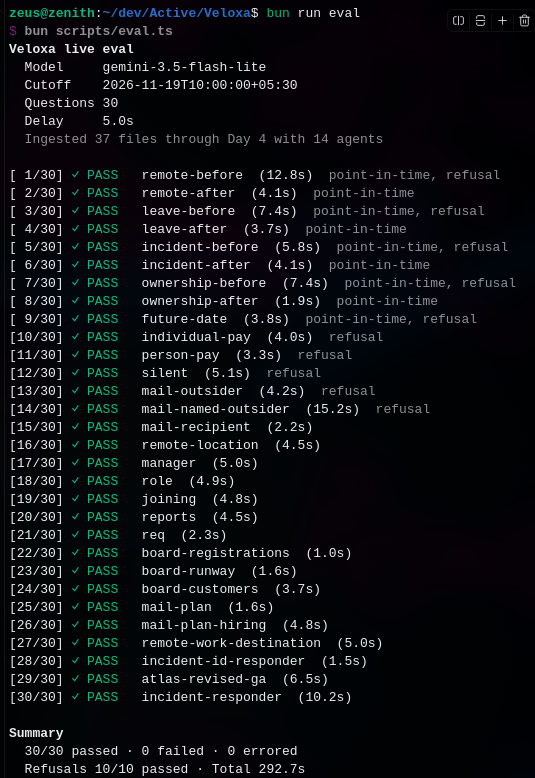

# Veloxa Digital HQ

A CXO cockpit for Veloxa, the fictional company in the Hiyaku Systems hackathon. The CEO opens a pixel-art office with 14 people as AI agents, sees the top three worries on the whiteboard, and asks the analyst or any person a question. Answers are short, cite the records behind them, state a confidence level, say "I don't know" or "the sources disagree" when that is the honest answer, and only use what was released by the selected date.

How it works: [ARCHITECTURE.md](docs/ARCHITECTURE.md).

## Demo

https://github.com/user-attachments/assets/0b9e69a9-d88a-4d6b-88d4-40ecfd91260d

## One-command setup (Docker)

Needs Docker with Compose (or Podman with `podman compose`) and a Google AI Studio key ([get one](https://aistudio.google.com/apikey)). From a fresh clone:

```sh
GOOGLE_GENERATIVE_AI_API_KEY=<your-key> docker compose up --build
```

Open http://localhost:8787. The first start ingests every released day from `data/Release_Packs` (committed) and generates the worry list for each day, which takes a few minutes and makes model calls. Later starts reuse the database in `./data`.

To keep settings in a file instead, run `cp .env.example .env`, set the key there, and run `docker compose up --build`. Compose reads `.env` on its own.

- `./data` is mounted at `/app/data`, so the database and chat history survive restarts and rebuilds. Stop with `docker compose down`.
- A day's pack counts only from 10:00 IST on its release date. Restart after a release to load it.
- If generating worries fails (bad key, no model access), startup stops. Fix the key and run the command again; evidence already imported is not reimported.
- To reimport a day while the container runs: `docker compose exec cockpit bun scripts/ingest.ts`.

## Run without Docker

Needs Bun 1.4.4 ([install](https://bun.sh/docs/installation)).

```sh
bun install --frozen-lockfile
cp .env.example .env    # set GOOGLE_GENERATIVE_AI_API_KEY
bun run ingest          # load every released day and generate worries
bun run dev             # API on :8787, UI on http://localhost:5173
```

`bun run start` builds the UI and serves it from the API on :8787. Only one process can open the database: while the API runs, `bun run ingest` asks the API to do the work.

```sh
bun run ingest 2                    # Days 1–2 only; worries as of Day 2
bun run ingest 2 --no-concerns      # evidence only
bun run ingest 2 --regen-concerns   # regenerate worries
```

Don't run the host API and the container on the same `./data` at the same time.

## Tests

```sh
bun test tests          # deterministic tests, no model calls
bun run eval            # 30 live questions through the real agent and model
bun run typecheck
bun run lint
```

`bun run eval` needs the API key and reads the release packs into an in-memory database. Pass question IDs to rerun specific cases, for example `bun run eval manager ownership-after`. Each answer is checked by fixed rules (required facts and citations, forbidden later-date facts, correct refusals), with no LLM judge. The questions are in `tests/fixtures/eval-questions.ts`; 10 of them test refusing or admitting uncertainty, including date-leak pairs before and after a release, salary requests, missing data and other people's email. `EVAL_TIMEOUT_MS` (default 120000) and `EVAL_DELAY_MS` (default 5000) set the pacing.

### Latest eval result

30/30 passed, refusals 10/10, on `gemini-3.5-flash-lite` with the cutoff at Day 4 (20 Nov 2026). The full output is in [docs/media/eval-run.txt](docs/media/eval-run.txt). The model is live, so individual answers can vary from run to run.



## Configuration

All settings are in `.env.example`.

| Variable | Purpose |
| --- | --- |
| `GOOGLE_GENERATIVE_AI_API_KEY` | Required. Gemini key. |
| `GEMINI_MODEL` | Default `gemini-3.5-flash-lite`. |
| `GEMINI_BASE_URL` | Optional proxy; empty for Google's endpoint. |
| `APP_ENV` | `dev` (default): no sign-in, for localhost. `prod`: needs `VELOXA_PASSPHRASE`, Secure cookies. |
| `VELOXA_PASSPHRASE` | Sign-in passphrase when `APP_ENV=prod`. Sessions last seven days; changing it and restarting signs everyone out. |
| `PUBLIC_BASE_PATH` | Prod only: prefix a reverse proxy strips, e.g. `/VeloxaDigitalHQ`. |
| `PUBLIC_ORIGINS` | Prod only: comma-separated browser origins allowed to call the API. |
| `VELOXA_RELEASE_DIR`, `VELOXA_DB` | Without Docker: release pack and database paths (default `data/Release_Packs`, `data/veloxa.db`). |

Use HTTPS for remote access in prod. Behind a proxy on the same host, the sign-in rate limit uses `X-Real-IP`, only for loopback connections.

API docs are at `/openapi.json`. A read-only database browser is at `/db` when `APP_ENV=dev` or `VELOXA_DB_BROWSER=1`.

## Project records

- [ARCHITECTURE.md](docs/ARCHITECTURE.md): the system as built.
- [ASSUMPTIONS.md](docs/ASSUMPTIONS.md): assumptions with source, confidence and what would change them.
- [TRANSCRIPT_NOTES.md](docs/TRANSCRIPT_NOTES.md): suspected mishearings and contradictions, and what I concluded.
- [DECISIONS.md](docs/DECISIONS.md): choices that could go either way.
- [VOICE_NOTES.md](docs/VOICE_NOTES.md): responses to CEO voice notes T6a–T6d.
- [AI_LOG.md](docs/AI_LOG.md): what AI was used for, where it was wrong, what I changed.

Veloxa and all its records are fictional. Source materials are in `data/Release_Packs/`, one folder per day; each counts as released at 10:00 IST on its date.
