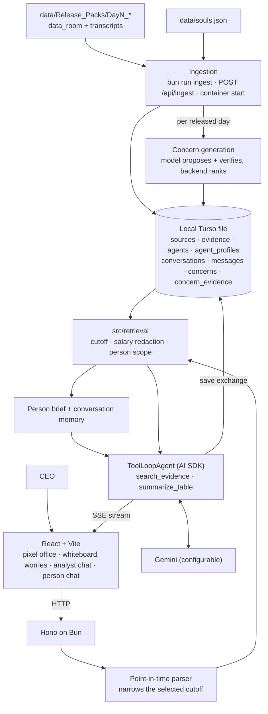

# Architecture



## What it is

A website for the CEO of Veloxa. She opens a pixel-art office with the 14 person agents at their desks, sees the top three worries on the whiteboard, and can ask either the company analyst or any one person a question. Every answer cites evidence rows, ends with a confidence line, and only uses material released by the selected knowledge cutoff.

Inputs are the daily `data_room` and `transcripts` folders. The repository's Markdown files are development records and are not ingested.

## Layout

```text
apps/web/src/          React UI (Office, Whiteboard, chat panel, evidence chips)
apps/api/src/          Hono app; routes/ has one file per resource
src/db/                Schema, Turso client, read-only browser
src/ingestion/         Release discovery, parsers, ingest, souls, startup initialisation
src/retrieval/         Cutoff filter, salary redaction, person scope, keyword search, person brief
src/chat/              Agent, prompts, point-in-time parser, tools, conversation history
src/concerns/          Evidence pack, generation + verification, scoring
src/agents/            Agent store and office layout (relationships, status, requests)
src/ai/                Model setup and generateStructured
scripts/               dev, ingest, eval, container entrypoint
tests/                 bun test suites; tests/fixtures/eval-questions.ts for the live eval
data/                  Release_Packs, souls.json, veloxa.db
```

`src/` never imports from `apps/`; the web app talks to the API only over HTTP. Only the API process opens the database file. When the API is running, `bun run ingest` asks it to do the work.

API routes: `/api/status`, `/api/agents` (people and office state at a cutoff), `/api/chat` (GET history, POST streams a reply, DELETE starts a new conversation), `/api/concerns`, `/api/ingest`, `/api/session`, `/api/login`, `/api/logout`. `/openapi.json` documents them. A read-only database browser at `/db` is enabled only with `APP_ENV=dev` or `VELOXA_DB_BROWSER`. With `APP_ENV=prod`, a passphrase (`VELOXA_PASSPHRASE`) protects the site.

## Ingestion

- Releases are discovered as `DayN_*` folders under `data/Release_Packs` (or `VELOXA_RELEASE_DIR`). A day counts only from 10:00 IST on its release date; packs not yet released are skipped.
- Only `data_room/` and `transcripts/` are read; `brief/` and `data_room/templates/` are not company evidence.
- Each file becomes one `sources` row (path, sha256, type, kind, release day, `released_at`). Parsers (xlsx, csv, docx, pdf, eml, txt) turn it into `evidence` rows with an exact locator (sheet/row, page, paragraph). Structured fields go in `data_json`; restrictions and other interpretations go in `metadata_json`.
- Re-ingesting is idempotent per path + hash. Earlier evidence and conversations are never deleted.
- After evidence, ingestion syncs the 14 agents and their dated profiles from each employee export, loads souls from `data/souls.json`, and generates concerns for every released day that has none.
- The container entrypoint runs the same initialisation on start, then starts the API.

## Data model

| Table | Purpose |
| --- | --- |
| `sources` | One row per original file version: path, sha256, file type, `data_room`/`transcript`, release day, `released_at` |
| `evidence` | Extracted passages and rows: locator, text, `data_json`, `metadata_json` |
| `agents` | Stable identity of the 14 people: ID, name, email, join date, soul |
| `agent_profiles` | Department, title, manager, location, status, exit date, keyed by `effective_from` = release of the export that recorded it (D033) |
| `conversations` | One per chat; `kind` is `analyst` or `person`, `agent_id` null for the analyst |
| `messages` | AI SDK message parts as JSON, with the `knowledge_cutoff` they were asked under |
| `concerns` | Ranked worries per cutoff: title, description, impact, urgency, evidence strength, reasons, score, rank, model |
| `concern_evidence` | Evidence rows behind each concern, with rationale |

There are no separate tables for entities, claims or conflicts. Aliases (A005) live in code; conflicts and source-trust decisions live in `TRANSCRIPT_NOTES.md` and `ASSUMPTIONS.md`.

The 14 agents are VX002–VX007, VX009–VX012, VX014, VX015, VX017 and VX018 (D024). Ananya (CEO), Sid (left 31 Oct), Divya, Imran, Kavya and the contractor Snehal have no agent; their records are still evidence.

## Answering a question

1. **Cutoff.** The UI sends the selected day. `pointInTime` (`src/chat/point-in-time.ts`) finds dates in the question with a regex parser ("18 Nov", "2026-11-18", "18/11", "last Monday", …). The cutoff becomes the end of that day (23:59 IST), but only ever narrows the selected cutoff, never widens it. The UI shows "Answering as of …".
2. **Evidence.** `evidenceAtCutoff` returns the latest version of each source released by the cutoff, drops restricted payroll rows and masks individual pay amounts in other text (A002).
3. **Person scope.** For a person agent, `scopedEvidence` keeps only rows connected to that person: emails they sent, received or were copied on; calls they spoke in; their own employee row, their manager's and their reports'; Jira, git, on-call, incident and leave rows naming them; and other rows that mention them. Agents can't see other people's email.
4. **Context.** A person agent gets a working brief (role, open Atlas tickets, recent commits, on-call, incidents, leave, mail, follow-ups still waiting, transcript mentions), each line tagged `[E<id>]`, plus their soul and a summary of earlier conversations with the CEO before the cutoff. The analyst gets deterministic summaries of large tables and its recent chat history.
5. **Generation.** A `ToolLoopAgent` (`src/chat/agent.ts`) with up to 3 steps. Tools: `search_evidence` (keyword search, TF-IDF with stemming and misheard-name aliases; exports scored slightly above transcripts) and `summarize_table` (analyst only). The cutoff, person scope and pay rules are passed in by the backend; the model can't change them. If nothing was found, the last step is forced to admit it.
6. **Answer.** Short, with `[E…]` citations, "I don't know" or "the sources disagree" when that's the honest answer, and a final `Confidence: high|medium|low — reason` line. The reply streams to the UI over SSE. It's saved only if it completed and was grounded in the brief or a search.
7. **No record.** If the selected person has no profile at the narrowed date, the reply comes from code without a model call.

Chat citations are not validated at runtime; the eval checks them.

## Concerns ("what should I worry about")

Generated at ingestion for each release cutoff, so a Day 1 view never uses Day 2 evidence. Using `generateStructured`, the model proposes concerns from a cutoff-filtered evidence pack and scores impact, urgency and evidence strength from 1 to 3, giving reasons. A second pass checks each claim against only the rows it cites. Concerns with invalid citations are dropped. If too few remain, the previous briefing is kept. The backend ranks with `score = 2 × impact + urgency + evidence strength`, ties broken by urgency. The whiteboard shows the top three; every scored concern is stored and viewable.

| Factor | 1 | 2 | 3 |
| --- | --- | --- | --- |
| Impact | Limited | Team-level | Company or critical project |
| Urgency | Monitor | Act soon | Act now |
| Evidence strength | Tentative or conflicting | Direct single source | Corroborated independent sources |

## Office view

`officeAtCutoff` (`src/agents/office.ts`) builds what the office shows at a cutoff, all from cited evidence:

- reporting lines and open-item lines, drawn on hover or focus;
- one status icon per person: leave, then on-call, then an unresolved item, then recent work, hidden after 30 days;
- a raised hand for recorded requests to the CEO, with "no response found" when none is recorded.

People appear and leave according to their dated profiles.

## Trust rules

- Exports are preferred over machine transcripts but don't settle a conflict on their own. Conflicts are reported, and the owner records the reasoning in `TRANSCRIPT_NOTES.md`.
- The cutoff, person scope and salary rules are enforced in `src/retrieval`, never left to the model.
- Invented personal details (souls, A008) shape tone only and are never evidence.

## Model and deployment

- AI SDK with Google Gemini (`GEMINI_MODEL`, default `gemini-3.5-flash-lite`; key in `GOOGLE_GENERATIVE_AI_API_KEY`). If the key is missing, a clear error is shown instead of an answer.
- Small talk uses low thinking; questions that need evidence use the model default.
- `bun run dev` starts the API on :8787 and Vite on :5173. `bun run start` builds the UI and serves it from the API.
- Docker: one container (Bun 1.4.4) holds the API, the built UI and the embedded database. `compose.yaml` mounts `./data` so the database, release packs and conversations survive container replacement.

## Verification

- `bun test tests`: deterministic tests for ingestion and re-ingestion, cutoff and pay filters, dated profiles and reorgs, office relationships and status, chat history, auth, the database browser and container init.
- `bun run eval`: 30 live questions, 10 of them refusal or uncertainty cases (`tests/fixtures/eval-questions.ts`), through the real agent and model against the ingested database. Checked by fixed rules, with no LLM judge: required phrases and citations, forbidden later-date facts, and refusals. Includes date-leak pairs (before and after a release), salary refusals, "no record" answers and agent-to-agent email boundaries. `EVAL_TIMEOUT_MS` (default 120 s) and `EVAL_DELAY_MS` control pacing. Latest run: 30/30 passed ([output](media/eval-run.txt)).

## Not built

Agents that keep generating new activity after 31 Oct 2026 (stretch goal).
